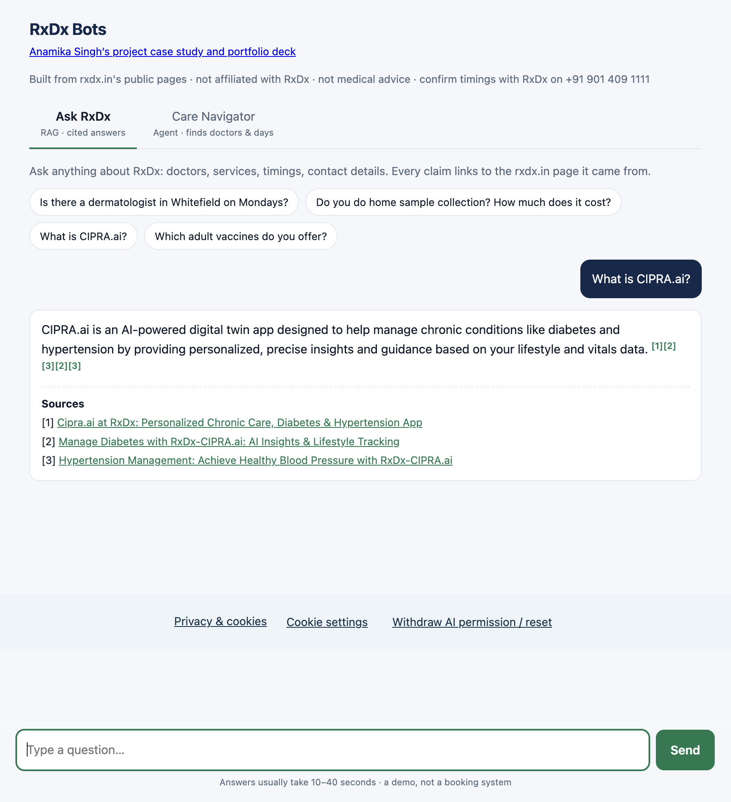

# RxDx bots & AI demos — Anamika Singh

RxDx clinic information is spread across doctor profiles, branch pages and service
descriptions. I built a RAG Q&A bot to bring those sources into one conversation,
with links back to the evidence. Its Care Navigator extension helps visitors filter
doctors by speciality, branch and published days, then prepare a booking-request draft.

This repository also contains four interactive demos for nonprofit and healthcare
workflows. Together, they show my work with retrieval, structured tools and model
integration using **Python, FastAPI and Amazon Bedrock**.

**[Try the RxDx bots](https://anamikasingh.vercel.app/bots)** ·
**[Explore the portfolio](https://anamikasingh.vercel.app/#work)**



## What I built and why

I used hybrid BM25 and embedding retrieval for RxDx to combine exact names and terms
with semantic matches, then fused the results with reciprocal-rank fusion. For doctor
navigation, I used structured directory tools so branch, speciality and day filters
are applied explicitly. A useful challenge here is incomplete source data: missing
availability stays unknown rather than becoming an invented appointment slot.

The public demos run on Amazon Nova Lite. RxDx also includes Anthropic API and local
Claude CLI adapters. A committed NumPy index keeps the small corpus simple to deploy;
Vercel OIDC provides short-lived AWS credentials for hosted inference.

## Projects and code

| Project | What it demonstrates | Start here |
| --- | --- | --- |
| **RxDx RAG Q&A** | Source cleanup, overlapping chunks, hybrid retrieval and source-linked answers | [chunking](rag-qna/rxdx_qna/chunking.py), [retrieval](rag-qna/rxdx_qna/index.py), [answer adapters](rag-qna/rxdx_qna/answer.py) |
| **Care Navigator** | Normalised directory filters, bounded tool use, emergency screening and validated booking drafts | [directory](care-navigator/navigator/directory.py), [tools](care-navigator/navigator/tools.py), [agent](care-navigator/navigator/agent.py) |
| **FundBot** | FAQ retrieval, fictional supporter segmentation and outreach drafting | [fixtures and tools](web/live_demos.py), [API](app.py), [tests](tests/test_live_demos.py) |
| **Post-discharge assistant** | Care-plan lookup and temporary checklist confirmation state | [tools and state](web/live_demos.py), [client](web/portfolio_assets/live-client.mjs) |
| **Clinical / FHIR** | Patient/Observation lookup, latest-observation selection and blood-pressure component extraction | [FHIR tools](web/live_demos.py), [tests](tests/test_live_demos.py) |
| **AID assistant** | Patient/observation tools and explicit reporting of missing evidence | [model loop and tools](web/live_demos.py), [case study](web/portfolio.py) |

## Architecture

```text
RxDx Q&A
public source snapshot -> clean/chunk -> BM25 + embeddings -> fused passages
question + recent history -> retrieved evidence -> model -> answer + sources

Care Navigator
visitor constraints -> emergency screen -> model/tool loop -> directory filters
                     -> doctor options or a booking-request draft

Portfolio assistants
browser -> FastAPI validation and rate limits -> allowlisted tools <-> Bedrock
        -> answer, visible tool calls and temporary demo state
```

[app.py](app.py) serves the API, [web/core.py](web/core.py) selects the RxDx backend
and handles history, and [web/live_demos.py](web/live_demos.py) implements the four
portfolio assistants. FundBot uses BM25 over its small FAQ fixture; RxDx uses the
hybrid index. The browser resends six recent messages. Portfolio assistants are
limited to five model rounds, and the navigator to eight tool calls.

## Results and evaluation

The committed RxDx snapshot contains **343 records and 427 chunks**, with an index
of about **1.3 MB**. On a curated **30-question retrieval evaluation**:

| Metric | Result |
| --- | --- |
| Hit@1 | 0.83 |
| Hit@3 | 0.93 |
| Hit@8 | 1.00 |
| Mean reciprocal rank | 0.889 |

These measure retrieval on a small evaluation set, not generated-answer accuracy.

Last reported verification, **13 October 2026**: **117 Python tests and 13 Node tests
passed**, covering API contracts, tools, retrieval, conversation history, emergency
screening examples and browser privacy/request handling.

## Run locally

Use Python 3.12 and Node.js 20 or newer for the JavaScript checks.

```bash
python3 -m venv .venv
source .venv/bin/activate
python -m pip install -r requirements-dev.txt
python -m uvicorn app:app --host 127.0.0.1 --port 8000
```

Open `http://127.0.0.1:8000/portfolio` for the portfolio and deterministic previews,
`/bots` for RxDx, and `/health` for configuration status. Pages and synthetic
previews work without inference credentials. For live model requests, follow
[backend setup and deployment](OPERATIONS.md#backend-configuration) with your own credentials.

To run the checks:

```bash
python -m pytest --import-mode=importlib \
  tests rag-qna/tests care-navigator/tests
node --test tests/test_live_client.mjs tests/test_portfolio_demos.mjs
python rag-qna/eval/run_retrieval.py --misses
```

Project-specific CLI instructions: [RxDx setup](rag-qna/README.md) ·
[Care Navigator setup](care-navigator/README.md).

## Demo scope

RxDx uses a public clinic-data snapshot; the other demos use fictional records.
This is independent work, unaffiliated with RxDx, and is not a medical or clinical
service. Booking requests and outreach are drafts; demos do not make appointments,
send messages, process payments or write to patient systems. The AID demo reports
missing evidence and has no live guideline, FDA or weather lookup.

The four additional demos publish Nova Lite implementations, not the complete
older AWS prototypes. Test results do not establish clinical or regulatory validation.
Use public or fictional inputs only.

See [setup, hosting, privacy and source-maintenance details](OPERATIONS.md) and the
[public privacy notice](https://anamikasingh.vercel.app/privacy).
